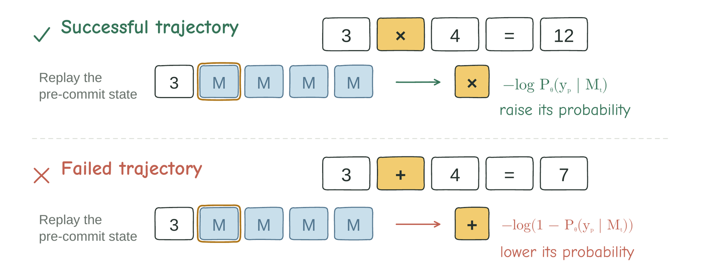
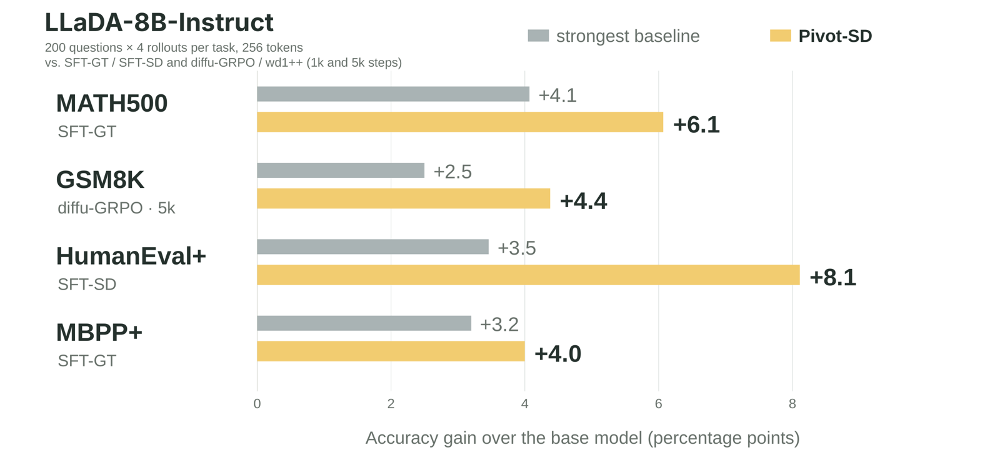

<div align="center">

# Pivot-SD: Efficient Self-Distillation for Masked Diffusion Language Models

### 🎤 EMNLP 2026 Main Conference · **Oral Presentation**

**Seo Hyun Kim**<sup>1,2,\*</sup> · **Sunwoo Hong**<sup>1,2,\*</sup> · Younwoo Choi<sup>2</sup> · Chen-Hao Chao<sup>2</sup> · Se-Young Yun<sup>1,†</sup> · Rahul G. Krishnan<sup>2,†</sup>

<sup>1</sup>KAIST AI &nbsp;&nbsp; <sup>2</sup>University of Toronto & Vector Institute
<br><sub>\*Equal contribution &nbsp; †Corresponding authors</sub>

<br>

[](https://sunwoohong.github.io/pivot-sd/)
[](https://aclanthology.org/2026.emnlp-main.2146/)
[](https://arxiv.org/abs/2610.03665)
[](https://aclanthology.org/2026.emnlp-main.2146/)
[](LICENSE)

</div>

---

## 📣 News

- **[Oct 2026]** 🎉 Pivot-SD was presented as an **Oral** at **EMNLP 2026** in Budapest.
- **[Nov 2026]** Code released, including the Dream-7B recipe and the budget-matched RL baselines.

## 💡 TL;DR

> **Training a diffusion LM doesn't need every token, just the few pivots that shape the rest of the generation.**

Pivot-SD puts a loss on only **10 tokens per response (<4%)** and, with just **200 questions × 4 rollouts**, outperforms full-sequence SFT and budget-matched diffusion RL on LLaDA-8B-Instruct across math and code, in **2.8 hours** on two GPUs.

<p align="center">
  
</p>

**Pivot-SD** is offline self-distillation for masked diffusion language models. A frozen **LLaDA-8B-Instruct** model samples a denoising trajectory. Each committed step is scored by how much it reduces the predictive entropy of the masks that remain in the active block. The top 10 steps are kept as pivots. Correct trajectories supply a cross-entropy target at the pivot token. Incorrect trajectories supply an unlikelihood target at that same token.

This repository reproduces that pipeline on LLaDA-8B-Instruct, the same recipe on Dream-v0-Instruct-7B, and the budget-matched diffu-GRPO and wd1++ baselines. Benchmarks are **MATH**, **GSM8K**, **HumanEval+**, and **MBPP+**. AceCode is the training set for the code benchmarks.

## 📊 Results

<p align="center">
  
</p>

LLaDA-8B-Instruct, 256-token generation, mean of three runs. All methods use the same budget: 200 questions, 4 rollouts each, 1,000 steps.

| Method | MATH500 | GSM8K | HumanEval+ | MBPP+ |
|---|---:|---:|---:|---:|
| LLaDA-8B-Instruct | 31.40 | 75.13 | 32.32 | 43.12 |
| SFT-GT | 35.47 | 76.94 | 33.94 | 46.32 |
| SFT-SD | 31.73 | 73.90 | 35.78 | 45.92 |
| diffu-GRPO | 33.47 | 76.04 | 32.52 | 43.39 |
| wd1++ | 33.27 | 76.93 | 33.54 | 43.12 |
| **Pivot-SD (ours)** | **37.47** | **79.51** | **40.43** | **47.12** |

## Installation

```bash
conda create -n pivot-sd python=3.10
conda activate pivot-sd

pip install -r requirements.txt
pip install -e .
```

`pip install -e .` makes `python -m pivot_sd...` importable. The shell scripts also prepend this directory to `PYTHONPATH`, so they run after `pip install -r requirements.txt` alone.

`regex` parses MATH answers. `human-eval` scores HumanEval+. HumanEval+ and MBPP+ problems are downloaded with `datasets` from `evalplus/humanevalplus` and `evalplus/mbppplus`. The `evalplus` package is not imported.

The main model is [LLaDA-8B-Instruct](https://huggingface.co/GSAI-ML/LLaDA-8B-Instruct). Dream runs use [Dream-v0-Instruct-7B](https://huggingface.co/Dream-org/Dream-v0-Instruct-7B). Pass a local directory or the Hugging Face id as `MODEL_PATH`.

RL baselines use a second environment. See [RL baselines](#rl-baselines).

## Data

MATH, GSM8K, and AceCode are not downloaded by this repository. Pass a local JSONL. One JSON object per line.

| Dataset | Required fields |
|---|---|
| MATH | `problem`, `solution` |
| GSM8K | `question`, `answer` |
| AceCode | `question`, `test_cases` |

HumanEval+ and MBPP+ are fetched at evaluation time. AceCode evaluation does not use `TEST_DATA`.

## Run

`scripts/run.sh` generates trajectories, builds pivots, trains, then evaluates. One GPU is the default. The reported jobs used two:

```bash
MODEL_PATH=/path/to/LLaDA-8B-Instruct \
DATA_PATH=/path/to/math_200.jsonl \
TEST_DATA=/path/to/math_test.json \
DATASET=math METHOD=pivot_sd \
GPU_ID=0,1 NUM_GPUS=2 \
bash scripts/run.sh
```

`DATASET` is `math`, `gsm8k`, or `acecode`. `METHOD=all` trains and evaluates every row in the table below. `STAGE=generate|build|train|eval` runs one stage.

Outputs:

| Stage | Path |
|---|---|
| Generation | `runs/<dataset>/gen/LLaDA/.../stepwise/` and `all_results.json` |
| Pivots | `runs/<dataset>/pivots/pivots_ig.jsonl`, `pivots_random.jsonl`, `pivots_entropy.jsonl` |
| Checkpoints | `runs/<dataset>/train/<dataset>_<method>/checkpoint-500` and `checkpoint-1000` |
| Eval | `runs/<dataset>/eval/<method>/...` |

### Generate

Four trajectories per problem, `alg=default`, temperature 0.9, length 256, block 64, 256 steps. One token is committed per step.

```bash
MODEL_PATH=/path/to/LLaDA-8B-Instruct \
DATA_PATH=/path/to/math_200.jsonl \
DATASET=math \
bash scripts/generate.sh
```

AceCode uses the `kodcode_v3` prompt and puts the first three test cases in the prompt. GSM8K uses the same script with `DATASET=gsm8k`.

### Build pivots

```bash
MODEL_PATH=/path/to/LLaDA-8B-Instruct \
DATA_PATH=/path/to/math_200.jsonl \
DATASET=math \
bash scripts/build_pivots.sh
```

`SELECTORS="ig_density"` builds only the main file. `random_step` and `entropy` build the selection ablations. AceCode requires `all_results.json` next to the stepwise directory, because correctness comes from executing the tests.

The ranking score is `info_gain_density`:

```text
density = (U_excl - U_next) / max(remaining masks in the active block, 1)
```

`U_excl` is the entropy sum, before the commit, over active-block masks that this step does not write. `U_next` is the active-block entropy sum on the next forward. Entropy is Shannon entropy in nats, `-sum(p log(p + 1e-10))`, on the clean softmax.

IG and random-step ranking drop block-boundary steps (`step > 0`, `step % 64 == 0`, and not the final step), EOS, and `<|eot_id|>`. Negative densities are dropped. Entropy ranking keeps boundary steps and ranks individual committed tokens by their stored token entropy. The top 10 are kept. Advantage is min-max scaled at the 1st and 99th percentiles and written into the JSONL. The 200-problem files are not rebalanced.

### Train

LoRA `r=128`, `alpha=256`, dropout 0.05, on `q_proj`, `k_proj`, `v_proj`, `o_proj`, `up_proj`, `down_proj`, `gate_proj`. Learning rate `1e-5`, weight decay 0.1, batch size 1, gradient accumulation 4, 1000 steps, bfloat16. Math and GSM8K use sequence length 512. AceCode uses 768.

The sign of the advantage selects the loss. Positive rows use cross-entropy. Negative rows use unlikelihood. The scaled magnitude is not multiplied into the loss.

Unlikelihood weight: MATH 1, GSM8K 5, AceCode 0.02. `positive_all`, `positive_pivot`, and `entropy_pivot` set the weight to 0, which drops incorrect trajectories. `posneg_all` uses 0.5.

```bash
MODEL_PATH=/path/to/LLaDA-8B-Instruct \
DATA_PATH=/path/to/math_200.jsonl \
DATASET=math METHOD=pivot_sd \
bash scripts/train.sh
```

### Evaluate

Greedy decoding, temperature 0, `alg=default`. Length 256 uses 256 steps. Length 512 uses 512 steps and block 64. Checkpoints at steps 500 and 1000 are both evaluated.

```bash
DATASET=math METHOD=pivot_sd \
TEST_DATA=/path/to/math_test.json \
bash scripts/evaluate.sh
```

```bash
DATASET=acecode METHOD=pivot_sd \
bash scripts/evaluate.sh
```

AceCode trains one model and evaluates HumanEval+ and MBPP+. A checkpoint directory that contains `adapter_config.json` is loaded as a LoRA adapter on top of the base model named in that file.

## Methods

| `--method` | State | Target | Positive | Negative | MATH | GSM8K | HumanEval+ | MBPP+ |
|---|---|---|---|---|---|---|---|---|
| `positive_all` | IG density | all supervised masks | CE | — | 31.60 | 74.37 | 36.59 | 39.68 |
| `positive_pivot` | IG density | pivot token | CE | — | 32.20 | 72.48 | 35.37 | 43.65 |
| `entropy_pivot` | token entropy | that token | CE | — | 32.27 | 74.75 | 35.57 | 44.80 |
| `posneg_all` | IG density | all supervised masks | CE | state unlikelihood, weight 0.5 | 35.00 | 74.44 | 36.80 | 44.54 |
| `random_step` | 10 random steps | pivot token | CE | pivot unlikelihood | 29.93 | 76.51 | 39.00 | 44.80 |
| `random_token` | IG density | random masked token in the pivot block | CE | pivot unlikelihood | 34.87 | 76.47 | 34.78 | 45.24 |
| `pivot_sd` | IG density, top 10 steps | pivot token | CE | pivot unlikelihood | 37.47 | 79.51 | 40.43 | 47.12 |

`random_token` reads `pivots_ig.jsonl`. The random index is chosen when the loss is computed, inside the same generation block of 64 tokens. `random_step` reads `pivots_random.jsonl`. `entropy_pivot` reads `pivots_entropy.jsonl`. The others read `pivots_ig.jsonl`.

Rows marked in the paper as three-run averages (`entropy_pivot`, `posneg_all`, `random_step`, `random_token`, `pivot_sd`) resample the 200 training questions, the trajectories, and the training seed.

## Configuration

Environment variables read by `scripts/lib.sh`:

| Variable | Default | Role |
|---|---|---|
| `DATASET` | `math` | `math`, `gsm8k`, or `acecode` |
| `METHOD` | `pivot_sd` | One method above, or `all` |
| `MODEL_PATH` | — | LLaDA-8B-Instruct |
| `DATA_PATH` | — | Train JSONL |
| `TEST_DATA` | — | MATH or GSM8K test JSONL |
| `GEN_LENGTH` | `256` | Generation length. Eval allows 256 or 512 |
| `BLOCK_LENGTH` | `64` | Active block size |
| `STEPS` | `GEN_LENGTH` | Denoising steps |
| `NUM_SAMPLES` | `4` | Trajectories per problem |
| `TEMPERATURE` | `0.9` | Generation only. Eval is greedy |
| `TOP_K` | `10` | Pivots kept per trajectory |
| `MAX_STEPS` | `1000` | Training steps |
| `SAVE_STEPS` | `500` | Checkpoint interval |
| `SEED` | `42` | Train seed and random-step base seed |
| `NUM_GPUS` | `1` | `accelerate launch --num_processes` |
| `GPU_ID` | — | Sets `CUDA_VISIBLE_DEVICES` |
| `BACKBONE` | `llada` | `llada` or `dream` |

Generation confidence (`--alg`) is `default`, `random`, `topk_margin`, or `entropy`. The reported trajectories use `default`: the confidence of the sampled token, then top-k unmasking inside the active block. `topk_margin` is top-1 probability minus top-2. `entropy` uses negative entropy as a confidence score. The entropy-pivot ablation does not use that sampler. It ranks tokens that were already committed, by the entropy stored in the stepwise log.

## Dream

`BACKBONE=dream` runs the same pipeline on Dream-v0-Instruct-7B. Sampling is Dream's maskgit schedule (`alg=maskgit_plus`): several tokens can be written on one step, and the logits are shifted by one position before the loss, which is how Dream aligns a token with the position it fills. Information gain is the average entropy drop over the masks that are still open. There is no 64-token block, so the block-boundary filter is off. Training still keeps the top 10 steps and uses the same unlikelihood weights.

```bash
BACKBONE=dream \
MODEL_PATH=Dream-org/Dream-v0-Instruct-7B \
DATA_PATH=/path/to/math_200.jsonl \
TEST_DATA=/path/to/math_test.json \
DATASET=math METHOD=pivot_sd \
bash scripts/run.sh
```

Generation temperature is 0.9. Evaluation is greedy. On the 256-token setting the Dream runs in the paper are:

| Method | MATH | GSM8K | HumanEval+ | MBPP+ |
|---|---:|---:|---:|---:|
| Dream-v0-Instruct-7B | 37.97 | 79.55 | 54.27 | 60.58 |
| SFT-GT | 35.40 | 61.49 | 54.27 | 59.26 |
| SFT-SD | 40.80 | 70.74 | 48.78 | 61.38 |
| Pivot-SD | 42.20 | 81.88 | 58.54 | 61.64 |

## RL baselines

diffu-GRPO and wd1++ are the online baselines in the main table. Both train from LLaDA-8B-Instruct with LoRA `r=128`, `alpha=64`, learning rate `3e-6`, 4 completions per prompt, block 64, 256 diffusion steps, and 1000 optimizer steps on the same 200-prompt file. wd1++ is `trainer_type=wll_d1_neg`. diffu-GRPO is `trainer_type=d1`. Prompts longer than 512 tokens are dropped. AceCode puts the first three test cases in the prompt.

Install this stack in its own environment. It pins a different `transformers` and a specific `trl` commit, and it needs DeepSpeed (ZeRO-2) and flash-attn. If flash-attn is not available, set `attn_implementation: sdpa` in the yaml under `baselines/wd1/`.

```bash
conda create -n pivot-sd-rl python=3.10
conda activate pivot-sd-rl
pip install -r baselines/requirements.txt
```

```bash
METHOD=wd1pp DATASET=math \
MODEL_PATH=GSAI-ML/LLaDA-8B-Instruct \
DATA_PATH=/path/to/math_200.jsonl \
GPU_ID=0,1 NUM_GPUS=2 \
bash baselines/run_rl.sh
```

`METHOD=diffu_grpo` runs the other baseline. `DATASET` is `math`, `gsm8k`, or `acecode`. The 5,000-step rows use a 2,000-prompt file and `MAX_STEPS=5000`.

Checkpoints are LoRA adapters. Score one with the Pivot-SD eval entry point:

```bash
python -m pivot_sd.evaluate \
  --model-path runs/math/rl/wd1pp/checkpoint-1000 \
  --save-dir runs/math/eval/wd1pp/math/checkpoint-1000 \
  --dataset math \
  --data-path /path/to/math_test.json
```

Reported wall-clock on two L40s, 1,000 steps: diffu-GRPO 5.4 h, wd1++ 3.6 h, Pivot-SD 2.8 h including the one-time trajectory sample.

## Layout

| Path | Role |
|---|---|
| `pivot_sd/decode.py` | LLaDA block decoder and stepwise entropy logs |
| `pivot_sd/dream_decode.py` | Dream maskgit sampler and the logit shift used in training |
| `baselines/` | diffu-GRPO and wd1++ |
| `pivot_sd/scoring.py` | `info_gain_density` and top-10 selection |
| `pivot_sd/build_pivots.py` | Stepwise JSON to pivot JSONL |
| `pivot_sd/methods.py` | The seven training recipes |
| `pivot_sd/trainer.py` | Masked-state dataset and CE / unlikelihood loss |
| `pivot_sd/train.py` | Training CLI |
| `pivot_sd/generate.py` | Trajectory sampling CLI |
| `pivot_sd/evaluate.py` | Greedy evaluation CLI |
| `scripts/` | Generate, build, train, evaluate |

## Citation

If you find Pivot-SD useful, please cite:

```bibtex
@inproceedings{kim-etal-2026-pivot,
    title = "Pivot-{SD}: Efficient Self-Distillation for Masked Diffusion Language Models",
    author = "Kim, Seo Hyun  and
      Hong, Sunwoo  and
      Choi, Younwoo  and
      Chao, Chen-Hao  and
      Yun, Se-Young  and
      Krishnan, Rahul G",
    editor = "Lee, Hung-Yi  and
      Dev, Sunipa  and
      Li, Jessy  and
      Elliott, Desmond",
    booktitle = "Proceedings of the 2026 Conference on Empirical Methods in Natural Language Processing",
    month = oct,
    year = "2026",
    address = "Budapest, Hungary",
    publisher = "Association for Computational Linguistics",
    url = "https://aclanthology.org/2026.emnlp-main.2146/",
    pages = "48790--48806",
    ISBN = "979-8-89176-459-0"
}
```

## Acknowledgements

This codebase builds on [LLaDA](https://github.com/ML-GSAI/LLaDA), [Dream](https://github.com/DreamLM/Dream), [d1](https://github.com/dllm-reasoning/d1), and [wd1](https://github.com/xiaohangt/wd1). HumanEval+ is scored with [HumanEval](https://github.com/openai/human-eval). HumanEval+ and MBPP+ problems come from the EvalPlus Hugging Face datasets.
